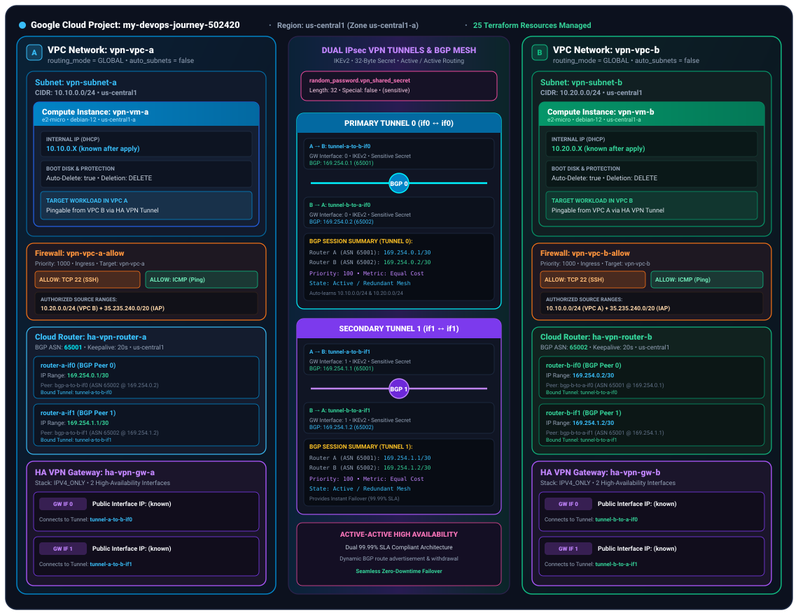
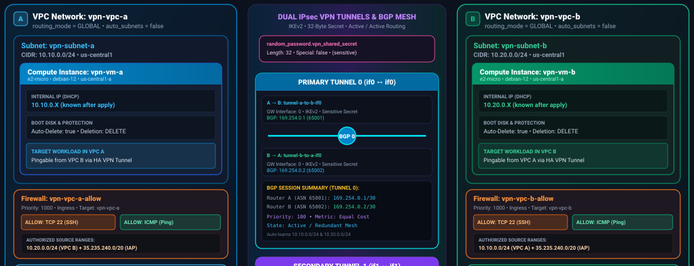
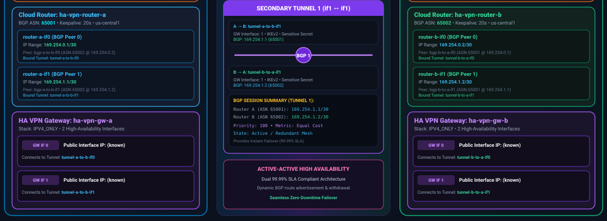
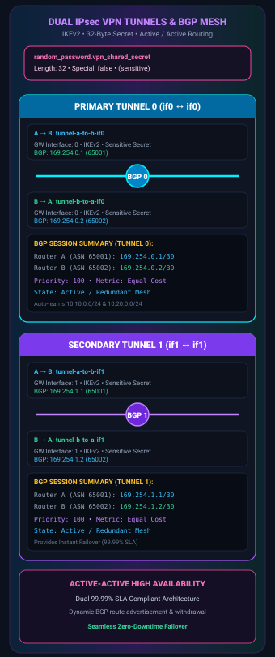

# HA VPN with Cloud Router & Dynamic BGP (`3-ha-vpn-bgp`)

In `2-2VPCs`, we connected `vpc-a` (`10.10.0.0/24`) and `vpc-b` (`10.20.0.0/24`) using **VPC Network Peering**, where GCP's control plane automatically exchanged subnet routes at zero hourly cost.

In this lab, we connect the **exact same two subnets** using **HA VPN + Cloud Router + eBGP** so you can see how encrypted data-plane tunnels and dynamic BGP route exchange are built in Terraform.

> **Cost Warning:** Unlike VPC Peering, VPN tunnels bill hourly (`~$0.05/tunnel/hour` × 4 tunnels = `~$0.20/hr`). Always run `terraform destroy` immediately after verifying BGP state and ping connectivity.

---

## 1. VPC Peering vs. HA VPN + BGP

| Dimension | VPC Network Peering (`2-2VPCs`) | HA VPN + Cloud Router (`3-ha-vpn-bgp`) |
| :--- | :--- | :--- |
| **Where used** | GCP-to-GCP within the same or peered orgs | Hybrid Cloud (GCP ↔ On-Premises, AWS, Azure) or regulated GCP boundaries |
| **Data Plane** | Google Andromeda SDN fabric (no encryption overhead, full line rate) | IPsec IKEv2 encrypted tunnels (`~3 Gbps` per tunnel, scales horizontally with ECMP) |
| **Control Plane** | Automatic subnet route exchange inside GCP | **Cloud Router** speaking **eBGP** over `169.254.x.x/30` link-local tunnel interfaces |
| **Transitive Routing?** | Never transitive (`A ↔ B ↔ C` cannot route `A ↔ C`) | Can be made transitive via Cloud Router custom route advertisements (`CUSTOM` mode) |
| **Availability SLA** | Inherits VPC SLA | **99.99% SLA** when 2 active/active tunnels connect Interface `0→0` and Interface `1→1` |

---

## 2. Resource Mapping: Theory to Terraform

| Networking Concept | GCP Terraform Resource | Role in the Architecture |
| :--- | :--- | :--- |
| **Global Dynamic VPC** | `google_compute_network` (`routing_mode = "GLOBAL"`) | Allows Cloud Router to advertise/program routes across **all** regions, not just its local region |
| **HA VPN Gateway** | `google_compute_ha_vpn_gateway` | Regional data-plane gateway that automatically allocates **two** public IPs (`vpn_interfaces[0]` & `[1]`) in separate failure domains |
| **BGP Control Plane** | `google_compute_router` | Pure control-plane BGP speaker (traffic **never** passes through Cloud Router!). Holds local ASN (`65001` or `65002`) |
| **IPsec Tunnel** | `google_compute_vpn_tunnel` | Encrypts traffic between gateway interfaces using IKEv2 + `shared_secret`. Need **4 tunnels** total (2 per direction: `if0` and `if1`) |
| **Tunnel Link-Local IP** | `google_compute_router_interface` | Assigns a `/30` APIPA IP (`169.254.0.1/30`, `169.254.0.2/30`) inside each tunnel so the two routers can talk |
| **eBGP Peering Session** | `google_compute_router_peer` | Establishes TCP port `179` BGP session to the remote router's `169.254.x.x` IP and remote ASN |

---

## 3. Architecture & Visual Breakdown

> **Docs Site Version:** [`docs/gcp-labs/03-ha-vpn-bgp.md`](../../docs/gcp-labs/03-ha-vpn-bgp.md) · **Interactive HTML:** [`gcp_ha_vpn_architecture_diagram.html`](gcp_ha_vpn_architecture_diagram.html)

### Full Topology Overview (25 Resources)



### Part A: VPCs (`GLOBAL` Routing), Subnets, VMs & Ingress Firewalls



### Part B: Control Plane (Cloud Routers `ASN 65001` ↔ `65002`) & Data Plane (HA VPN Gateways)



### Part C: Dual Active/Active IPsec Tunnels (`if0` & `if1`) & `169.254.x.x/30` BGP Mesh



### Key BGP Concepts Demonstrated in `main.tf`

1. **Why two different ASNs (`65001` vs `65002`)?**
   - BGP between two networks uses **eBGP (External BGP)**, which requires each side to have a distinct Autonomous System Number.
   - Private ASNs come from RFC 6996 (`64512`–`65534`). Note: `65515` is reserved by Google for Partner Interconnect, and `16550` for Cloud VPN/Interconnect in specific contexts.
2. **Why `169.254.x.x/30` inside the tunnels?**
   - An IPsec tunnel is a point-to-point virtual wire. For BGP (which runs over TCP port `179`) to open a socket across that wire, both ends of the tunnel need an IP address.
   - GCP requires RFC 3927 link-local (`169.254.0.0/16`) `/30` subnets. Each `/30` gives 2 usable host IPs:
     - **Tunnel 0:** Router A = `169.254.0.1/30` ↔ Router B = `169.254.0.2/30`
     - **Tunnel 1:** Router A = `169.254.1.1/30` ↔ Router B = `169.254.1.2/30`
3. **Active/Active ECMP vs. Active/Passive (`advertised_route_priority`)**
   - Both `router_a_peer0` and `router_a_peer1` set `advertised_route_priority = 100` (BGP **MED** — Multi-Exit Discriminator; lower value = higher preference).
   - Because both tunnels advertise `10.10.0.0/24` with the **same** priority (`100`), VPC B installs **both** tunnels as equal-cost next hops and load-balances traffic across them using **ECMP (Equal-Cost Multi-Path)**.
   - If you wanted **Active/Passive** instead, you would set Tunnel 0's priority to `100` and Tunnel 1's priority to `200`.
4. **Custom Route Advertisements (Hub-and-Spoke / On-Premises)**
   - By default, `advertise_mode = "DEFAULT"` advertises all subnets in the VPC.
   - If `vpn-vpc-a` also needed to advertise an on-premises summary route or a peered CIDR (e.g., `192.168.0.0/16`), you would change `router_a` or `router_a_peer0` to:
     ```hcl
     advertise_mode    = "CUSTOM"
     advertised_groups = ["ALL_SUBNETS"]
     advertised_ip_ranges {
       range       = "192.168.0.0/16"
       description = "On-prem corporate network"
     }
     ```

---

## 4. Verification Commands (When Applied)

```bash
# 1. Initialize and inspect the 21-resource plan (safe, zero cost)
terraform init
terraform plan

# 2. If you apply to test live BGP (remember to destroy right after!):
terraform apply

# 3. Check that all 4 IPsec tunnels reached ESTABLISHED status
gcloud compute vpn-tunnels list --filter="region:us-central1"

# 4. Inspect live BGP sessions, learned prefixes, and MED priorities on Router A
gcloud compute routers get-status ha-vpn-router-a \
  --region=us-central1 \
  --format="yaml(result.bgpPeerStatus, result.bestRoutesForRouter)"

# 5. Check the VPC A route table to see 10.20.0.0/24 learned dynamically via BGP ( two ECMP next hops!)
gcloud compute routes list --filter="network:vpn-vpc-a"

# 6. SSH into vpn-vm-a via IAP and ping vpn-vm-b across the encrypted IPsec tunnel
gcloud compute ssh vpn-vm-a --zone=us-central1-a --tunnel-through-iap --command="ping -c 4 $(terraform output -raw vm_b_ip)"

# 7. Destroy immediately to stop hourly tunnel billing
terraform destroy
```
