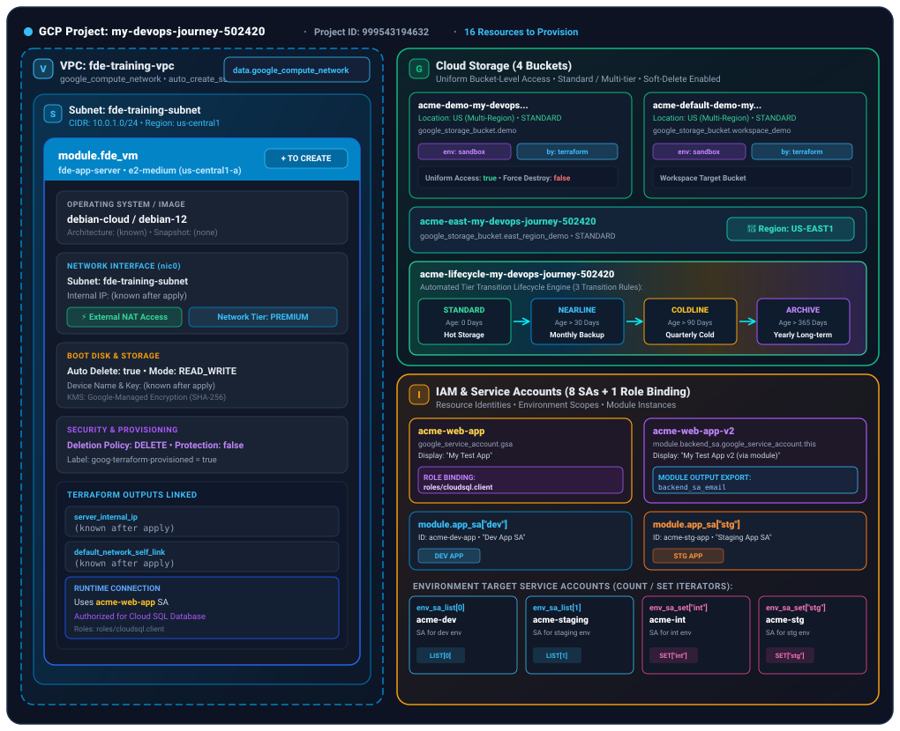
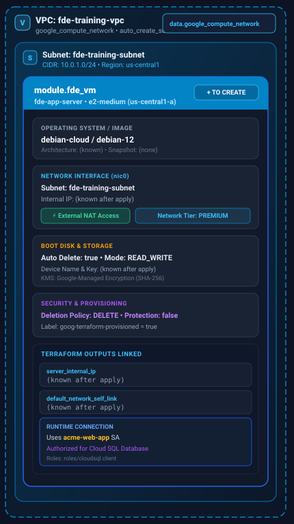
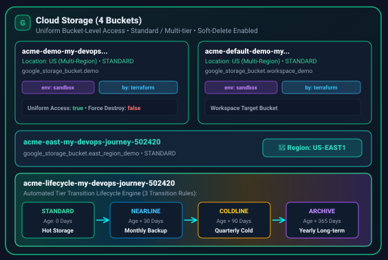
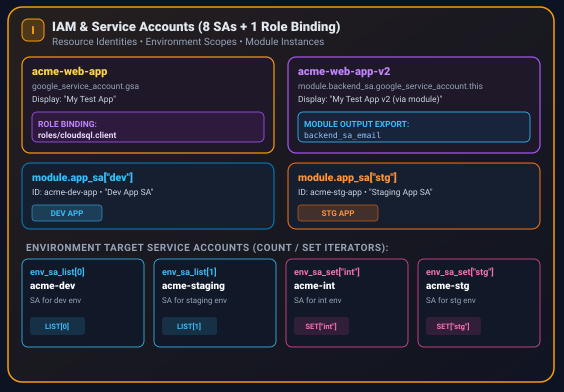

# Lab 4 — Core GCP Resources: Modules, Storage, Providers & IAM

**Code:** `02-gcp-terraform/core-gcp-resources/` · **Resources Planned:** `16` (`+ 2 data sources`) · **Interactive View:** [Open Interactive Dashboard :material-open-in-new:](dashboards/4-core-gcp-resources-architecture.html){ target="_blank" }

---

## 1. Full Architecture Overview

`core-gcp-resources` is the all-in-one GCP root practicing **reusable child modules**, **provider aliasing (`google.us_east`)**, **`count` vs. `for_each` repetition**, **`dynamic` nested blocks**, **workspaces**, and **live `data` sources**.

Because this root spans three distinct GCP domains (VPC/Compute, Cloud Storage, and IAM), the full diagram below is followed by **three focused zone diagrams** so each subsystem is clear at a glance.

*Click any diagram to zoom in full screen, or [launch the interactive HTML inspector](dashboards/4-core-gcp-resources-architecture.html){ target="_blank" }.*

---

## 2. Visual Breakdown by Zone (3 Focused Views)

### Zone 1 — VPC, Subnet, Live `data` Source & Reusable VM Module (`modules/gcp-vm`)

The left zone of the architecture provisions `fde-training-vpc`, `fde-training-subnet` (`10.0.1.0/24`), a live `data.google_compute_network` lookup, and the `module.fde_vm` child module:

- **Default vs. Aliased Provider Inheritance:** Child modules (`module.fde_vm`, `module.backend_sa`, `module.app_sa`) automatically inherit the **default (unaliased) `provider "google"` block** from `main.tf`. If only an aliased provider (`alias = "us_east"`) is defined in the root, Terraform synthesizes an empty default `provider "google" {}` with no `project`, causing `project: required field is not set` errors.
- **Input Validation Guardrail (`modules/gcp-vm/variables.tf`):** Enforces cost compliance at `plan` time using `can(regex("^(e2-|n1-|n2-)", var.machine_type))`.
- **Deferred Data Source Read (`<= read`):** Because `data.google_compute_network.default` references `google_compute_network.vpc.name` (which does not exist until `apply`), Terraform automatically defers the data source read until `apply` rather than failing during `plan`.

---

### Zone 2 — Cloud Storage: Workspaces, Provider Alias (`US-EAST1`) & `dynamic` Lifecycle Rules

The top-right zone provisions **4 GCS buckets** demonstrating four distinct Terraform mechanics (`resources.tf`):

1. **`google_storage_bucket.demo`:** Uses `local.common_labels` and sets `uniform_bucket_level_access = true` explicitly to satisfy GCP Org Policy constraints (`constraints/storage.uniformBucketLevelAccess`).
2. **`google_storage_bucket.workspace_demo`:** Interpolates `${terraform.workspace}` into the bucket name (`acme-default-demo-...`) to prevent global GCS naming collisions across workspaces.
3. **`google_storage_bucket.east_region_demo`:** Routes to the secondary aliased provider via `provider = google.us_east` (unquoted reference) to provision in `US-EAST1`.
4. **`google_storage_bucket.lifecycle_demo`:** Uses a `dynamic "lifecycle_rule"` block iterating over `local.lifecycle_rules` to generate three storage-class transitions (`STANDARD` → `NEARLINE` @ 30d → `COLDLINE` @ 90d → `ARCHIVE` @ 365d) without repeating nested HCL blocks.

---

### Zone 3 — IAM & Service Accounts (`count` List vs. `for_each` Set vs. `for_each` Module)

The bottom-right zone provisions **8 Service Accounts** and **1 Project IAM Binding** comparing every Terraform repetition pattern side by side:

| Address in State | How It Is Created | Key/Index Stability when First Item Removed |
| :--- | :--- | :--- |
| `google_service_account.gsa` + `google_project_iam_member.sa_sql_client` | Single resource + implicit reference (`member = "serviceAccount:${google_service_account.gsa.email}"`) | Single instance |
| `module.backend_sa.google_service_account.this` | Single child module call (`./modules/service_account`) | Single instance |
| `module.app_sa["dev"]`, `module.app_sa["stg"]` | `for_each = var.service_accounts` (`map(object)`) over a `module` block | **Stable** — keyed by map key (`"dev"`, `"stg"`) |
| `google_service_account.env_sa_set["int"]`, `["stg"]` | `for_each = var.environment_set` (`set(string)`) | **Stable** — keyed by string value (`"int"`, `"stg"`) |
| `google_service_account.env_sa_list[0]`, `[1]` | `count = length(var.environment_list)` (`list(string)`) | **Fragile** — removing index `0` (`"dev"`) shifts `"staging"` from `[1]` → `[0]`, forcing replacement |

---

## 3. Interactive Inspector (Embedded)

??? example "Expand Interactive Component Inspector inline"
    <iframe src="../dashboards/4-core-gcp-resources-architecture.html" width="100%" height="840" style="border: 1px solid #23314d; border-radius: 12px;" loading="lazy"></iframe>
