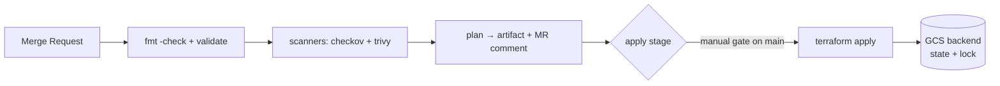

# 12 — Security Scanning, Policy-as-Code & Terraform in CI

The missing half of Terraform fluency: how code gets **verified** (scanners,
policy engines) and how it gets **applied** (pipelines, not laptops).

---

## 1. Static analysis for Terraform — three tools, three lenses

| Tool | Scans | Finds | Where it runs |
|------|-------|-------|---------------|
| **checkov** | `.tf` source | 750+ policies: open firewalls, public buckets, missing encryption, overly-broad IAM | pre-commit, CI, `checkov -d .` |
| **trivy config** (absorbed tfsec) | `.tf` source | misconfig with severity + fix hints | `trivy config .` |
| **conftest** (OPA/Rego) | `terraform show -json` **plan output** | *contextual* rules — "this SG opens 0.0.0.0/0 **and** is attached to prod" — things source can't see | `conftest test tfplan.json` |

The distinction that matters in an interview:

> **Source scanners see intent; plan scanners see reality.** A variable or
> module can hide a dangerous value that only appears in the evaluated plan.
> Gate on the **plan**.

## 2. Lab: run all three against `02-gcp-terraform`

```bash
cd 02-gcp-terraform

# Source-level scans — find the intentional misconfigs in the lab code:
checkov -d . --framework terraform --quiet
trivy config . --severity HIGH,CRITICAL

# Plan-level scan — the powerful one:
terraform plan -out=tfplan
terraform show -json tfplan > tfplan.json
```

`policy/deny_public_ssh.rego`:

```rego
package main

deny[msg] {
    rc := input.resource_changes[_]
    rc.type == "google_compute_firewall"
    rc.change.after.source_ranges[_] == "0.0.0.0/0"
    msg := sprintf("%s opens to the world", [rc.address])
}
```

```bash
conftest test tfplan.json --policy policy/
# 1 failure — the plan-level view caught what a reviewer could miss
```

!!! warning "Never commit tfplan"
    `terraform show -json` output contains *evaluated* values — including
    secrets marked sensitive in state. Treat plan JSON like state: artifact
    it inside the pipeline, never commit it.

## 3. Terraform in CI — the shape that production teams use



| Design decision | The rule |
|-----------------|----------|
| Who applies | **The pipeline's service account** — never user creds. Your user gets `plan` only; the SA gets `apply`. This is the DaVita bootstrap pattern. |
| State | Remote backend (GCS) — local state in CI is a footgun; the backend provides the lock too. |
| Locking | `Error acquiring the state lock` = another pipeline holds it. Fix the pipeline order, don't `-force-unlock` casually (that's for abandoned locks only). |
| Drift | Scheduled pipeline: `terraform plan -detailed-exitcode`; exit 2 = drift detected → alert. |
| Reviews | Plan output posted to the MR (artifact or comment) — the reviewer approves the *plan*, not the HCL diff alone. |

Minimal GitLab CI shape:

```yaml
stages: [validate, plan, apply]

tf:validate:
  stage: validate
  script: [terraform fmt -check -recursive, terraform init -backend=false, terraform validate]

tf:plan:
  stage: plan
  script:
    - terraform init
    - terraform plan -out=tfplan -detailed-exitcode || test $? -eq 2
  artifacts:
    paths: [tfplan]
    # the artifact IS the deployable — apply consumes this exact plan

tf:apply:
  stage: apply
  dependencies: [tf:plan]
  script: [terraform apply tfplan]     # apply the artifact, not a re-plan
  rules:
    - if: '$CI_COMMIT_BRANCH == $CI_DEFAULT_BRANCH'
      when: manual                     # human clicks → pipeline SA applies
```

**Why apply the plan artifact?** `terraform apply tfplan` guarantees what
was reviewed is what runs — a re-plan could pick up drift that happened
between review and click.

## 4. Cost visibility — infracost

```bash
infracost breakdown --path . --terraform-var-file terraform.tfvars
# Monthly cost diff per resource — put it in the MR next to the plan
```

Pair with the acme runbook's cost warning: GKE nodes are the expensive
line; everything else in the sandbox is near-free. `infracost` in the plan
stage makes "what does this MR cost" a reviewable number.

## 5. Deliberate break & triage

- Commit a firewall with `source_ranges = ["0.0.0.0/0"]` → watch checkov
  fail the MR before a human ever reviews.
- Manually change a resource in the console → next scheduled drift plan
  exits 2. That's the detection loop working.
- Two MRs apply simultaneously → one gets `state lock` error. Now you know
  why applies are serialized (and why `when: manual` alone isn't enough in
  busy repos — add `resource_group`).

## Verify

- [ ] You ran all three scanners and can say what each uniquely sees
- [ ] You can draw the plan-artifact → apply flow and defend it
- [ ] You know the answer to "state lock error — what now?" that isn't
      `force-unlock`

## See also

- [10 — Multi-Repo, GKE, Networking & CI/CD](10-architecture-multirepo-gke-and-cicd.md)
- [05 — Variables, Locals & Security](05-variables-locals-and-security.md)
- `DockerConcepts` 07 — image-side supply chain (trivy/cosign)
